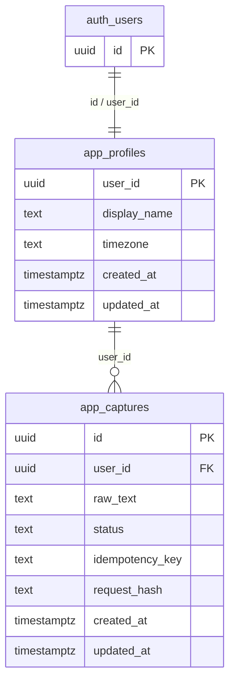

# ER図

Hibi 業務データの関係図です。正は `supabase/migrations` の DDL です。この図は関係の読み物であり、制約や権限の詳細は [テーブル定義](./15-table-catalog.md) に書きます。

## 更新タイミング

`supabase/migrations` で table / 主要な FK / 識別列を追加・変更・削除したら、**同じ PR** でこの図を更新する。列の check や GRANT だけの変更は [テーブル定義](./15-table-catalog.md) を先に直す。

## スキーマ

| schema | 役割 | 環境 |
| --- | --- | --- |
| `auth` | Supabase Auth が管理。Hibi は参照するだけ | local / preview / production で同じ名前 |
| `app` | Hibi 業務 table。Data API に出さない | local / preview / production で同じ名前 |

本番でも schema 名は `app` のままにする。環境ごとに `app_prod` へ分けない。環境の分離は Supabase project とデータを分けることで行う。

## 現状

`auth.users` は Supabase 管理の外部実体です。Hibi の migration は PK 参照と profile 作成 trigger だけを足します。

## 関係

| 親 | 子 | カーディナリティ | ON DELETE |
| --- | --- | --- | --- |
| `auth.users` | `app.profiles` | 1対1 | `CASCADE` |
| `app.profiles` | `app.captures` | 1対多 | `CASCADE` |

## 未実装（図に載せない）

Week 4 以降の outbox、処理結果列、検索用 embedding は、対応する migration を入れたときにこの図へ追加する。

## 関連

- [テーブル定義](./15-table-catalog.md)
- [Week 3 Capture 契約](./13-week3-capture-contract.md)
- [API・データ契約](./06-api-data-contracts.md)
